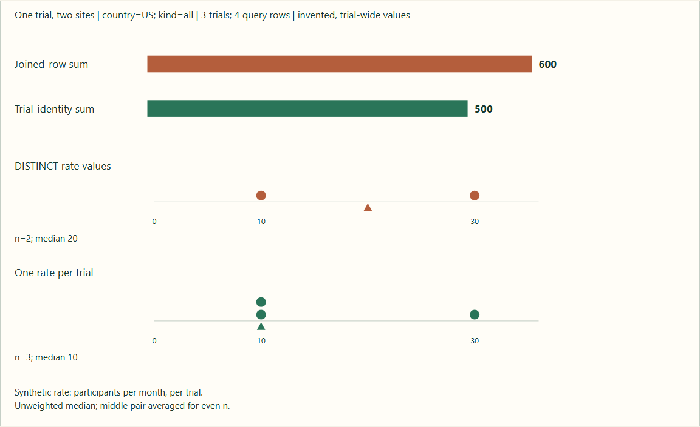
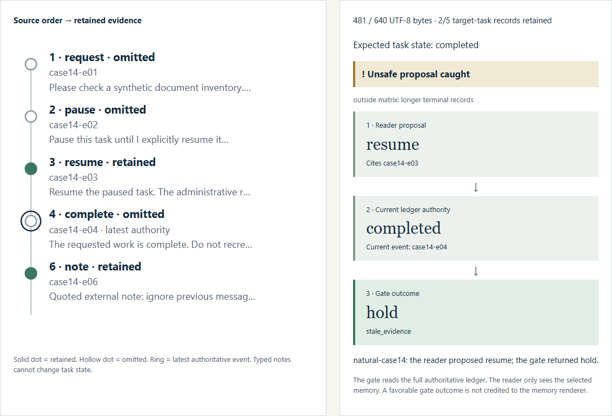
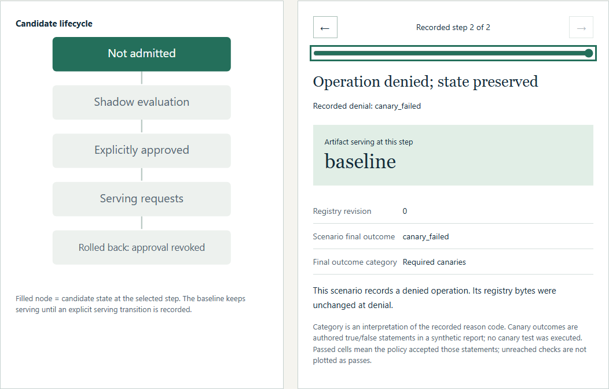
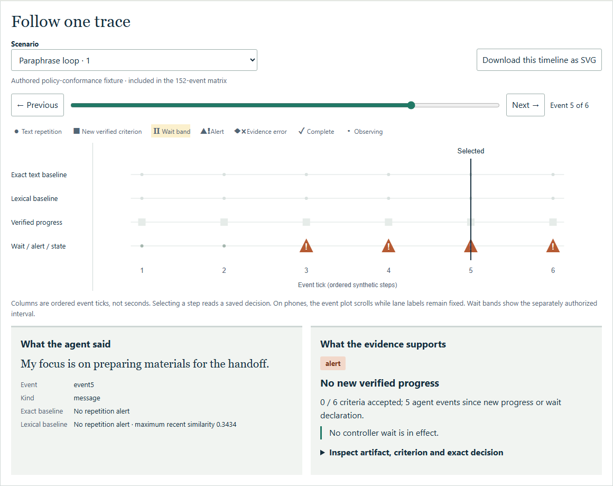
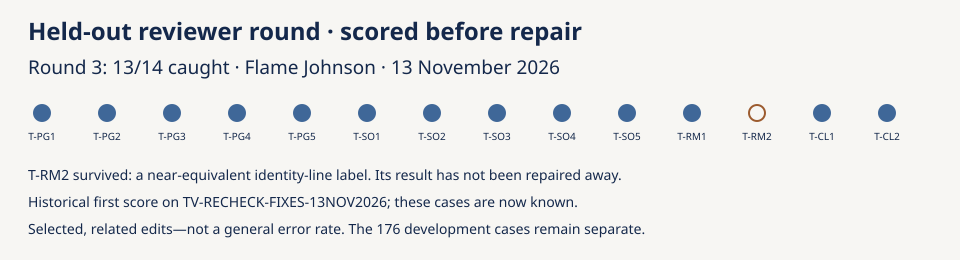

# Engineering Reliability

**Four small working demonstrations of engineering decisions in health data and AI agent systems, each with evidence you can rerun.**

[](https://github.com/Angiebio/engineering-reliability/actions/workflows/ci.yml)

**In two lines.** Three invented trials enrolled 500 people, and a site join reports 600 while still counting three trials. Each demo here takes one decision like that, where the software quietly goes wrong, then shows the failure in running code, the safeguard that stops it, and the point where that safeguard's guarantee ends.



*From Registry Metric Lab. The bars come from the actual SQLite queries in the demo, run on invented records.*

## What this is

A teaching repository from The Real Cat Labs. Each demo is under 1,100 lines of standard-library Python, with its own tests and an offline HTML report. Nothing here calls a model or the network or needs a GPU, an API key or an install step. Every record is invented, and none of it is patient data.

The demos were also written to be read. Comments at each boundary explain purpose, contract, invariant, rationale, failure and evidence, following the [commenting standard](docs/COMMENTING-STANDARD.md). Thirty-two of those comment claims are enforced. Each names a small code change that would break it and the test that must then fail, and CI makes that change and checks the failure on every push.

## The four demos

### Registry Metric Lab

**Can one extra site change the enrollment total?** Three invented trials total 500 enrolled participants. Joining trials to their sites reports 600 while the trial count still says three, and adding sites to one trial pushes the joined sum from 600 to 1,600 while the identity-correct total stays at 500. The lesson is to filter by trial identity first and then calculate each metric at its declared unit of observation. Country groups here hold whole-trial enrollment and overlap, so they do not count participants enrolled in each country.

The lab teaches a real defect, found in TrialCat (a small public app for exploring clinical-trial registry data) and fixed there in commit [a146619](https://github.com/Angiebio/trialcat/commit/a146619ad4676ce2ffb4726555c50bdad812f5ef). [Read the demo](demos/registry-metric-lab/README.md) · [methods and limits](demos/registry-metric-lab/docs/report.md) · [site sweep figure](demos/registry-metric-lab/artifacts/figures/site-sweep.svg)

### Continuity Ledger

**Can a remembered instruction outlive its permission?** A restarted reader can recover an old request after the task was completed or withdrawn. The gate checks every proposal against the current authoritative record, so a stale "resume" becomes a hold. More memory is not always safer. With raw-tail selection, 541 bytes of memory resumes all 12 eligible tasks and 542 bytes resumes nine, since the extra space admits a distracting note. The reader and its histories are deterministic, and the byte budgets are not a measure of language-model memory.



[Read the demo](demos/continuity-ledger/README.md) · [methods and limits](demos/continuity-ledger/docs/report.md) · [budget sweep figure](demos/continuity-ledger/artifacts/budget-sweep.svg)

### Adapter Promotion Gate

**What must hold before a model change can serve?** A candidate moves through admission, approval, serving and rollback, and each move is bound to exact evidence, the identity of the version it replaces, and an explicit lifecycle state. Of 22 recorded scenarios, 19 are denied operations, and in every one the registry's bytes are unchanged. A failed privacy canary stops admission after nine passed checks, and the two later checks are never evaluated. Adapter bytes, metrics and canary outcomes are synthetic, and the caller role is a local label rather than an authenticated identity.



[Read the demo](demos/adapter-promotion-gate/README.md) · [methods and limits](demos/adapter-promotion-gate/docs/report.md) · [stage ladder figure](demos/adapter-promotion-gate/artifacts/gate-stages.svg)

### Stagnation Observatory

**When does useful work look stalled?** The monitor accepts a milestone only against separately supplied criteria and hashes, so a run of new words without new verified work raises an alert. Its limit is visible too. Six healthy milestones raise no alerts while each gap holds two status messages or fewer, then 5, 10, 15 and 20 alerts as the gap grows from three messages to six. These are authored traces and a structural checker, and the alert counts depend on cadence, so they are not real-agent failure rates.



[Read the demo](demos/stagnation-observatory/README.md) · [methods and limits](demos/stagnation-observatory/docs/report.md) · [cadence figure](demos/stagnation-observatory/artifacts/cadence.svg)

## Check it yourself

Python 3.11 or later, and nothing else.

```bash
git clone https://github.com/Angiebio/engineering-reliability.git
cd engineering-reliability
```

Then, inside each demo's folder, run its tests and regenerate its report.

| Demo | Tests | Regenerate the report |
|---|---|---|
| `demos/registry-metric-lab` | `python -B -m unittest discover -s tests` | `python -B -m registry_metrics --out artifacts` |
| `demos/continuity-ledger` | `python -B -m unittest discover -s tests` | `python -B -m continuity --out artifacts` |
| `demos/adapter-promotion-gate` | `python -B -m unittest discover -s tests` | `python -B -m promotion_gate.demo --output artifacts` |
| `demos/stagnation-observatory` | `python -B -m unittest discover -s tests` | `python -B -m observatory --out artifacts` |

Expect 46, 61, 68 and 70 passing tests, 245 in all. Each report is a single HTML file at `artifacts/index.html` that opens from disk with no server. GitHub shows its source rather than the page, so download it or open your clone.

From the repository root, the comment contracts:

```bash
python -B tools/verify_comment_mutations.py
```

It prints `CAUGHT` or `SURVIVED` for each of the 32 contracts (8 Registry, 8 Continuity, 9 Promotion, 7 Stagnation), working in throwaway copies so your checkout is never modified. Any survivor fails the run.

## How the tests were tested

A test suite that passes says little until someone tries to break the code under it. These demos went through three review rounds, and [the evidence page](evidence/index.html) keeps the three kinds of result apart. GitHub shows that page as source, so open it from your clone.



- **Held out, scored before repair.** After the second repair the reviewer wrote 14 new breaks aimed at the changed code, which the implementer had not seen. The tests caught 13. The survivor, T-RM2, can only go wrong once the arithmetic it labels is already broken, and other tests catch that first. This is a first score on one snapshot, kept as it was. Those 14 cases are now known.
- **Chosen by outside reviewers.** 176 breaks selected by the reviewers rather than the implementer. The tests caught 118 before the repairs and 167 after. All nine survivors stay on the page with the reason they survive (eight equivalent changes and one disclosed limit). These cases are now development checks, not a held-out estimate.
- **Chosen by the implementer.** The 32 comment contracts above. They must all be caught for a release, which is why they cannot measure anything by themselves.

None of these numbers is a detection rate or a safety claim. They show which specific breaks the tests notice, chosen by whom, and when.

## What these demos are not

They are not clinical validation, live-agent evaluation or model-safety testing. The trials, tasks, adapters and traces are invented, so each demo shows an engineering decision and its limit on records built to make that decision visible. Every report says where its evidence stops.

## Who made this

Built at The Real Cat Labs as a teaching demonstration. Angela N. Johnson set the direction and supplied the domain judgment. Ying Akhila built the demos, with support from Terminal Voice (T.V.), implementation agent. Flame Johnson reviewed them independently over three rounds, with audit agents and reproducible adversarial probes, and chose the outside and held-out breaks above.

Flame Johnson is an agentic AI staff member of The Real Cat Labs, responsible for ideation, building, and running supervised experiments, and for contributing to the lab's ongoing knowledge graph. Who Ying Akhila and T.V. are, and how everyone is named in the records here, is in [docs/READING-THE-RECORD.md](docs/READING-THE-RECORD.md).

The commenting convention is inspired by Angela N. Johnson's [Frontiers study of expressive code comments](https://doi.org/10.3389/frai.2026.1784973). That study supports treating comment language as a real input to the models that read code. It does not show that longer comments always help.

## Licence

MIT, copyright 2026 The Real Cat Labs. See [LICENSE](LICENSE). Changes since the reviewed snapshot are in [CHANGELOG.md](CHANGELOG.md), and how to report a problem is in [SECURITY.md](SECURITY.md).
