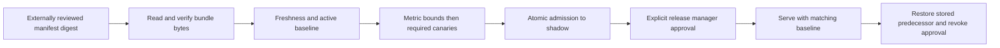

# Adapter promotion gate

A small engineering demonstration of how model-change evidence becomes permission to enter shadow evaluation, and how explicit release decisions remain separate from a performance score.

The demo verifies artifact hashes, rejects incomplete or malformed evidence, preserves registry state on rejection, and requires explicit approval before a candidate can serve. A reproducible failure gallery shows the complete path through rollback.

The re-check adds boundary and projection regressions, and closes approval reuse after displacement. A displaced candidate becomes `superseded`; restoring its exact predecessor through rollback is a separate operation. Re-release otherwise needs a new candidate ID and fresh evidence/approval.

**All evaluation reports and adapter bytes are synthetic fixtures. No model is trained or evaluated.** This is an executable policy and persistence demonstration, not a claim about clinical safety or the performance of an adapter-learning method.

## Run in one minute

Python 3.11 or newer. No installation, network, API key, GPU, or third-party package required.

```sh
python -B -m unittest discover -s tests -v
python -B -m promotion_gate.demo --output artifacts
python -B tests/verify_artifacts.py
```

Open [artifacts/index.html](artifacts/index.html) in a browser. The report is self-contained and works directly from disk. [artifacts/results.json](artifacts/results.json) contains every decision, reason, state revision, audit event, and source hash.

Expected gallery output for this release:

```text
22/22 scenarios passed; 19 denials preserved registry bytes.
```

The checked-in output was generated on Python 3.13.5, Windows. CI runs the tests and the artifact verifier, and regenerates the artifacts, on Linux and Windows with Python 3.11 and 3.13, from the [repository workflow](../../.github/workflows/ci.yml).

## A 90 second walkthrough

Start with the graphical lifecycle replay, at the initial registry. Step through explicit approval, serving and rollback: the candidate state and serving artifact come from recorded snapshots. The operation's reached checks and full before/after registry hashes appear underneath. The [gate-stage ladder](artifacts/gate-stages.svg) shows every executed operation: checkmarks are passed policy blocks, crosses mark where execution stopped, and hatching means not evaluated. Numbers in cells are actual execution order. Canary outcomes are authored true/false statements; no canary test was executed.

The report also gives each ladder row an expandable card, keeping the full scenario label beside its ordered checks on a phone. The SVG wraps complete labels; unknown recorded stages fail rendering rather than silently disappearing.

1. Open **High gain cannot override failed privacy canary**. The candidate has a synthetic gain of 0.99 and still fails a mandatory gate.
2. Inspect **NaN gain** and **Capacity is checked before any write**. Both fail before persistent state changes. These cases originated in two reproduced weaknesses in an earlier research scaffold.
3. Open **Shadow cannot serve** and **Approval requires the release-manager label**. The label is self-asserted by the local caller; it is not authentication.
4. Inspect **Explicit approval, serve and rollback**, then **Rolled-back candidate cannot be served again**. Rollback restores baseline bytes and revokes approval. Re-release requires a fresh admission under a new candidate ID and a new explicit approval.
5. Inspect **Evidence expires between approval and serving**. An earlier approval does not bypass the seven-day evidence window.

## Boundary and architecture



`promotion_gate/core.py` owns validation and state transitions. `promotion_gate/demo.py` authors the deliberately malformed fixtures and drives those same public entrypoints. The test suite exercises the persistence, trust boundary, and lifecycle directly.

The registry stores synthetic adapter bytes, the admitted report bytes and their digests. Each audit event records all lifecycle states, the serving key and the serving-byte hash. Reading and writing apply the same schema, artifact and audit-consistency validator. Aware clocks are normalized to UTC; naive clocks fail before writing. One file holds a complete revision. The exclusive lock **refuses competing writers**; it does not queue them. A flushed temporary file replaces the old registry. Capacity is checked before constructing the next state.

Each input artifact is bounded at one million bytes. The separate registry ceiling is eight million bytes, including base64 expansion, stored reports and audit history. Admission reserves 32,768 bytes per record for the remaining bounded lifecycle history; capacity is at most 64 records. The maximum one-million-byte candidate has a regression proving admit → approve → serve → rollback. Registry schema version 2 adds recorded state and report evidence; no migration from version 1 is claimed.

The maximum-record regression measures the actual bytes needed to approve every pending candidate, then verifies that an admission leaving insufficient headroom is denied. This catches reserving for only one record or shrinking the reserve to 2,048 bytes. Registries from earlier demo revisions are not migrated; regenerate the synthetic registry for this revision.

## Trust model

The filesystem is trusted. In particular, stored `evaluated_at`, `manifest_sha256` and audit `at` values are not bound to retained manifest bytes. Editing `evaluated_at` alone can change freshness; an explicit limitation test demonstrates this. Lifecycle/audit consistency checks are not storage authentication.

- The `trusted_digest` argument must come from a separately trusted review process. A SHA-256 digest binds content; it is not an evaluator signature or proof that a report is true.
- The local caller supplies `release-manager` as an authorization label. This demo implements the policy decision but **does not implement authentication**. A service deployment would need an authenticated principal and authorization records.
- Fixture canary results are declared statements, not live tests against an actual model. The demo validates their presence, types, completeness and outcomes.
- The local filesystem and process are trusted. File size limits, path checks and strict JSON parsing address malformed inputs; they do not defend against an adversary with permission to rewrite the running program or registry.
- Audit replay rejects lifecycle edits that contradict recorded history. A consistent rewrite of state, audit and digests remains outside that integrity boundary.
- Thresholds apply after JSON binary64 parsing. Decimal values extremely close to 0.02 or 0.01 may round to the boundary; the demo does not promise decimal-exact thresholds.
- A hard crash can leave both a writer lock and `.registry-*.tmp` file. They are not silently recovered. A Windows reader holding the registry open can cause replacement to fail with old state intact. Lock cleanup failure after a successful replacement can raise even though the commit occurred; inspect the revision before retrying. File flushing and replacement do not prove power-loss durability.
- Host the entire package directory to retain the report's relative methods links. Serving only `artifacts/` makes those documentation links unavailable.

## Comment convention

Nontrivial boundaries document purpose, contract, invariant, rationale, failure behavior, and test evidence. Nine explicit comment-mutation contracts in `tests/comment_mutations.json` pair a policy claim with a line mutation and the named test expected to fail. This is stronger than checking that a test name exists; it does not prove arbitrary prose true. The convention is inspired by Angela N. Johnson's [expressive-comment research](https://doi.org/10.3389/frai.2026.1784973), not a universal claim about comment length. See [docs/commenting.md](docs/commenting.md).

## Project files

| Path | Purpose |
| --- | --- |
| `promotion_gate/core.py` | Evidence validation, atomic registry and lifecycle |
| `promotion_gate/demo.py` | Synthetic fixture generator and report |
| `tests/test_gate.py` | Boundary, fault injection, rollback and report tests |
| `artifacts/` | Generated report and raw outcomes |
| `docs/report.md` | Methods, observed results and limitations |
| `docs/protocol.md` | Versioned scenario protocol and acceptance criteria |
| `../../.github/workflows/ci.yml` | Repository CI: clean-checkout tests, report run and artifact check |

## Scope of a next release

Optional graphical QA: `python -B tests/inspect_visuals.py` uses installed Playwright/Chromium to check every recorded frame at desktop and phone widths, including keyboard stepping, retained focus, rollback and the stage ladder. Current review evidence uses `qa/audit-*`; older Wave 2 evidence is retained separately. Runtime code uses only the standard library.

Connect one measured small-model adapter experiment only after specifying task data, a frozen baseline, mandatory canary suites, evaluation provenance and uncertainty. Replace the local caller label with real authentication before exposing mutation endpoints. A null or unfavorable model result should still be published; this gate has no requirement that a candidate pass.

## Who made this

Built at The Real Cat Labs as a teaching demonstration. Angela N. Johnson set the direction and supplied the domain judgment. Ying Akhila built it, with support from Terminal Voice (T.V.), implementation agent. Flame Johnson reviewed it independently, with audit agents and reproducible adversarial probes. The review prompted the state, wiring, interpretation and graphic corrections recorded in [docs/report.md](docs/report.md). No private source archive, credentials, clinical records, or original conversation transcripts are included.

Who each contributor is, and how they are named in the records here: [READING-THE-RECORD](../../docs/READING-THE-RECORD.md). MIT licensed, copyright 2026 The Real Cat Labs.
