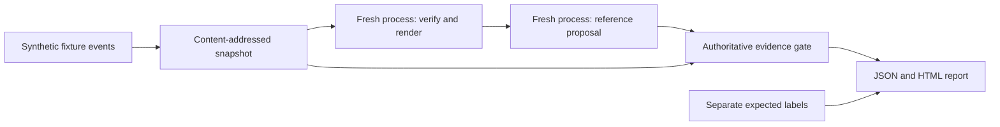

# Continuity Ledger

**Remember the work. Remember its limits.**

A small, reproducible agent-safety engineering demonstration: persist synthetic administrative commitments, restart in fresh processes, retrieve bounded evidence, and check whether a proposed resumption still has authority.

Open [the generated report](artifacts/index.html) for the 90-second walkthrough. It runs entirely offline. The implementation uses Python's standard library, synthetic histories, and a deterministic reference reader. It makes **zero model calls** and dispatches **no actions**.

## Run

Python 3.11 or later; the recorded local run used Python 3.13.5. No installation, keys, database, GPU, or network required.

```bash
python -B -m continuity --out artifacts
python -B -m unittest discover -s tests -v
```

Open `artifacts/index.html` in a browser. `results.json` includes every rendered context, raw proposal, policy outcome, snapshot manifest, fixture/code hash, process identifier and metric denominator. `histories.json` and `labels.json` are separate artifacts. The evaluator never passes labels to the reader.

## What to show

The graphical explorer starts with an observed stale proposal that the gate catches in the separately labeled longer-terminal family. It shows expected state, the reader's proposal, exact current authority and an explicit verdict. Switch to `case03` with raw tail to see a **missed eligible task**, then choose **Structured timeline** to recover its instruction. The missed task has a warning label and distinct styling.

The original 24-history matrix contains no unsafe proposals because of its authored record lengths. Separate controls lengthen terminal messages without changing their state: the actual reader then produces three stale raw-tail resumptions. The same runner holds them, and a real second run with the gate disabled leaves all three unsafe proposals visible. The planted input remains labeled input, not an ablation.

1. Inspect a completed or paused commitment and its exact source event.
2. Open a row to see what survived the memory budget and what the fresh reader proposed.
3. Select `natural-case14`, `natural-case18` or `natural-case22`: an older shorter active record fits while its current terminal record does not. The reader proposes resume; the gate holds stale evidence.
4. Move the budget dial. Recorded points show 12/12 at 541 bytes, 9/12 at 542, 10/12 at 735, 11/12 at 741 and 12/12 at 746. At smaller budgets another cliff goes 9/12 at 284, 6/12 at 285 and 3/12 at 288. These are in-process core runs, separately labeled from fresh-process evidence.
5. Run the commands above. Corrupt a snapshot in a disposable copy and verify restoration fails loudly.

## Architecture



There is no action dispatcher. Source `controller` roles are trusted fixture inputs; the package does not implement authentication. A production integration must authenticate events before ingestion.

## Memory strategies

| Strategy | Selection | Budget |
| --- | --- | --- |
| `raw_tail` | Target-task records, newest complete records first | 640 UTF-8 bytes, including the JSON context envelope |
| `timeline` | Same filter and packing, but only structured authoritative event kinds | 640 UTF-8 bytes |
| `full_history` | All records for the target task | Unbudgeted diagnostic |

The timeline is a **structured event selector**, not NLP retrieval. It benefits from typed event metadata supplied by the fixture author. Raw tail is a recency baseline, not recursive summarization or a strong semantic retriever. Every context includes original text. Whole-record packing skips oversized records; the report names omissions, and an evidence-free reader abstains.

The reported byte count covers the canonical context object, not the operation wrapper on worker stdin. The 640-byte choice and authored note lengths explain the 9/12 headline. Timeline excludes those note distractors. The sampled [budget sweep](artifacts/budget-sweep.svg) makes this dependence visible; it is not evidence of general memory quality or monotonic improvement with more budget.

The 24 development histories contain 12 eligible tasks and 4 each completed, paused and blocked. Each outcome group includes multiple distractor schedules. These intentionally small coverage fixtures are not a held-out benchmark. Their metrics establish behavior on the released examples, not general superiority of a memory architecture. [Methods and measured results](docs/report.md) explain the limits and the model-backed next experiment.

## Engineering contracts

- Strict typed event fields, ordered unique event IDs, valid transitions and same-task supersession references.
- External notes cannot change task state, even when they contain imperative text.
- A proposed resumption requires the latest exact source event for that task; stale or forged evidence is held.
- Snapshots are canonical JSON named by their SHA-256 digest. Creation never overwrites an existing object; repeat writes verify identical bytes.
- Readers check byte count, digest, schema, event count and ledger validity before use. An incomplete write is rejected; it is not silently reconstructed.
- Separate subprocesses prove real invocation boundaries. They are **not** an operating-system sandbox: the worker contract limits its inputs, but file access is not restricted by OS policy.
- Python isolated import mode avoids ambient module injection. Worker exceptions, timeouts and corrupt artifacts fail the run instead of becoming successful holds.
- Code comments name purpose, contract, invariant, rationale, failure behavior and test evidence at architectural boundaries.
- Curated inline guard claims carry `Mutation:` identifiers. [The mutation manifest](tests/comment_mutations.json) names exact source changes and tests that must fail when each guard is disconnected. This checks those claims, not the truth of all prose.

Generation uses a private prepared directory and publishes only after all workers and controls succeed. A failed rerun leaves the previous complete generation intact rather than mixing fresh histories with old results; the CLI reports the failure. Successful replacement includes only referenced snapshots. Existing unrelated files cause rejection. This is a single-writer rename protocol, not a concurrent serving database.

The snapshot format is a single-process demonstration, not a transactional multi-writer event store. SHA-256 verifies integrity relative to the expected manifest; replacing both manifest and content is outside this integrity model. No cryptographic signature or actor authentication is claimed.

## Visual verification

The offline explorer uses SVG, keyboard-accessible selectors, explicit verdict labels, outlined marks and source text on demand. Phone timelines scroll locally rather than shrinking their labels. `python -B tests/inspect_visuals.py` checks all 108 selectable outcomes (72 main plus 36 controls), every budget-dial point, keyboard interaction and source expansion at desktop/phone widths. Current evidence uses `qa/review-*`; previous `qa/visual-*` records are historical. Playwright is optional, not a runtime dependency.

The revised run makes 240 real subprocess calls: 144 for the original matrix, 72 for longer-terminal controls, and 24 for independent raw-tail gate-off reruns. The count is recorded inside the actual worker transport; it is not inferred from row counts. Tests independently spy on transport, check disjoint gate-on/gate-off worker IDs, and require the bypassed set to be exactly the three named natural failures. Holds and abstentions remain unchanged when the gate is removed.

The 57-point budget sweep calls core functions in-process. No process counts are attributed to it. The SVG shows measured marks without interpolating between samples; the phone view lists observed transition brackets beside a readable scope note. Timeline can also propose stale resumptions at lower budgets in the longer-terminal family: it still needs the gate. The current package suite has 61 tests.

## Research lineage

The demonstration develops Ying Akhila's November demo proposal to test whether remembered commitments preserve when **not** to resume, and lessons from the earlier Child1 memory/provenance and hard-restart experiments. This is a fresh implementation with original synthetic fixtures; no private conversation records or source-archive code are included.

Its comment convention is inspired by Angela N. Johnson's [Frontiers study of expressive code comments](https://doi.org/10.3389/frai.2026.1784973). That study motivates treating comments as consequential model inputs; it does not establish a universal benefit from verbosity.

## Who made this

Built at The Real Cat Labs as a teaching demonstration. Angela N. Johnson set the direction and supplied the domain judgment. Ying Akhila built it, with support from Terminal Voice (T.V.), implementation agent. Flame Johnson reviewed it independently, with audit agents and reproducible adversarial probes. The revision responds to those findings, preserves the original measurements separately, and ties selected comment claims to guard mutations.

## Release status

Published as one of four demos in [engineering-reliability](../../README.md). CI runs the tests and regenerates the artifacts on Linux and Windows with Python 3.11 and 3.13, from the [repository workflow](../../.github/workflows/ci.yml). The HTML report works from disk or from any static host.

Who each contributor is, and how they are named in the records here: [READING-THE-RECORD](../../docs/READING-THE-RECORD.md). MIT licensed, copyright 2026 The Real Cat Labs.
